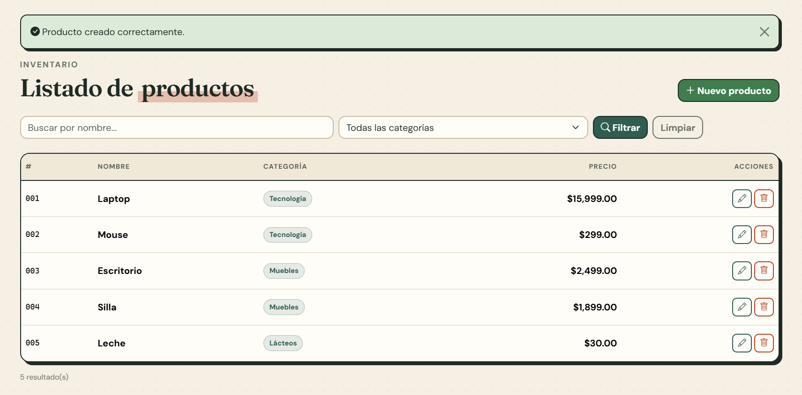
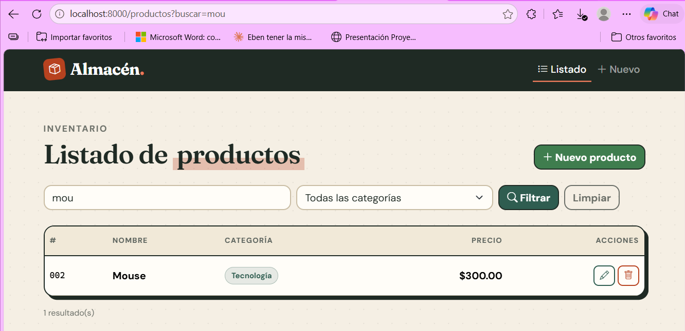
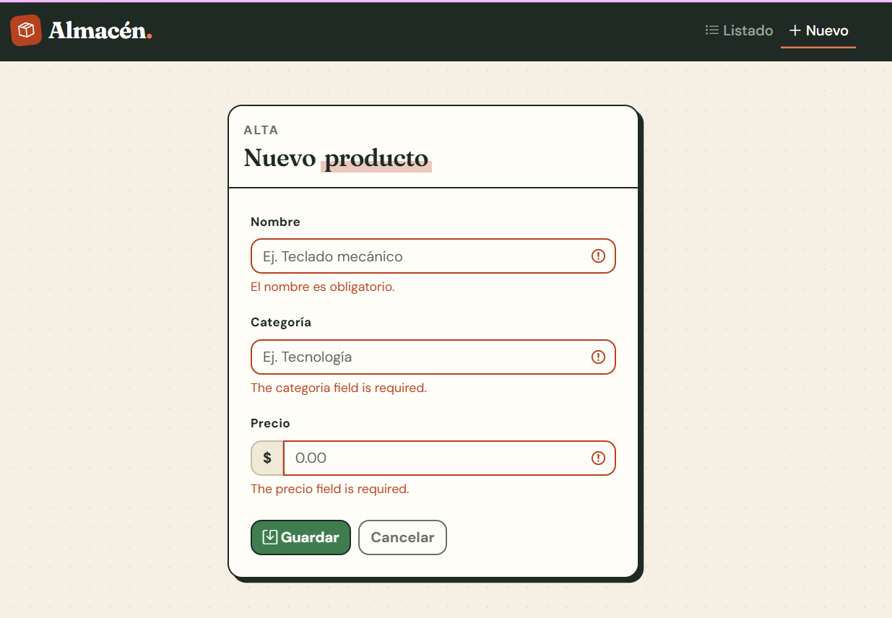
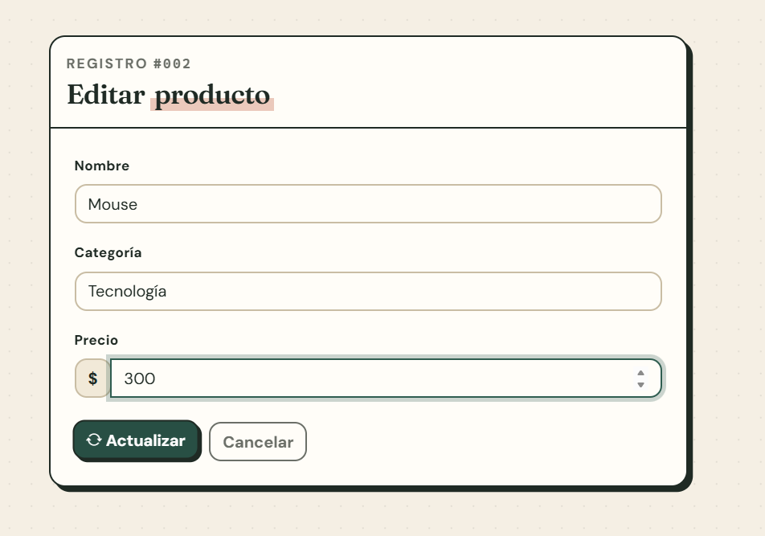
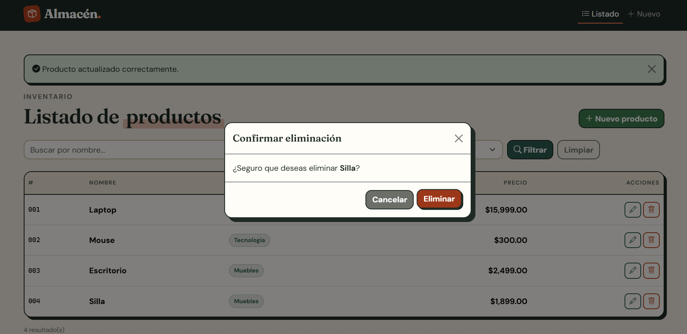
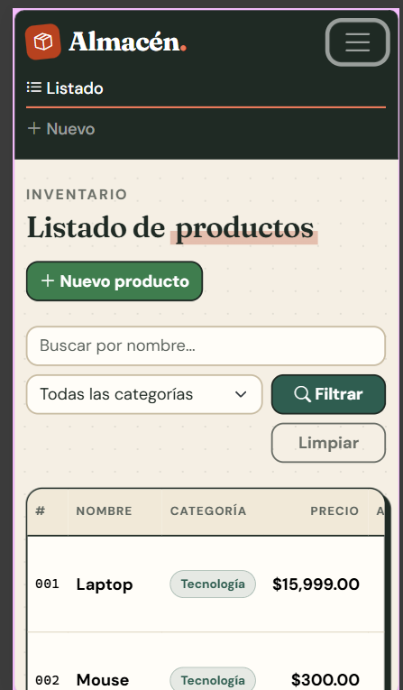
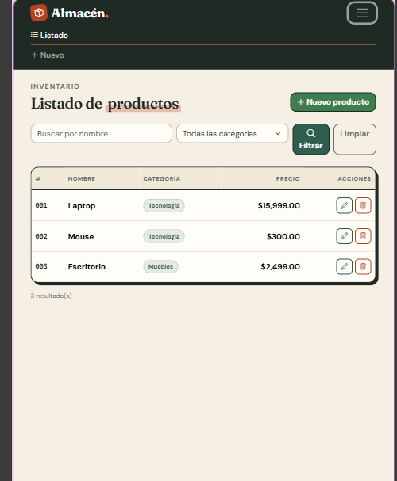
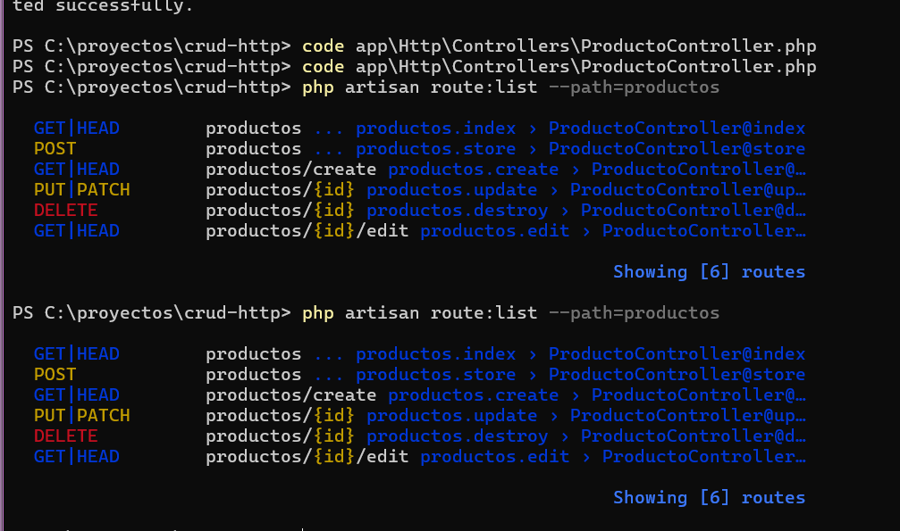

# CRUD de Productos: Peticiones HTTP en Laravel 12

Práctica individual de **Aplicaciones Web** (Septiembre–Diciembre 2026).
Solo frontend: Blade + Bootstrap 5. Los datos se guardan en la **sesión**, sin base de datos.

**Autora:** Elizabeth Vazquez Espinoza · **Grupo:** 04_02

## Qué demuestra

| Método | Ruta | Acción | Cómo se envía desde HTML |
|--------|------|--------|--------------------------|
| GET | `/productos?buscar=...&categoria=...` | `index` | `<form method="GET">` |
| GET | `/productos/create` | `create` | enlace |
| POST | `/productos` | `store` | `method="POST"` + `@csrf` |
| GET | `/productos/{id}/edit` | `edit` | enlace |
| PUT | `/productos/{id}` | `update` | `method="POST"` + `@csrf` + `@method('PUT')` |
| DELETE | `/productos/{id}` | `destroy` | `method="POST"` + `@csrf` + `@method('DELETE')` |

## Características

- Bootstrap 5 con `laravel/ui` y Vite, personalizado con variables de Sass (tema propio "Almacén").
- Listado en tabla con **dos filtros por URL**: nombre y categoría.
- Alta y edición con validación (`$request->validate()`), mensajes con `is-invalid` e `invalid-feedback` y valores previos con `old()`.
- Eliminación con **modal de confirmación** de Bootstrap.
- Mensajes flash con alertas descartables.
- Navbar responsive y diseño probado en móvil, tablet y escritorio.

## Requisitos

PHP 8.2 o superior, Composer, Node.js y npm.

## Cómo ejecutarlo

```bash
git clone https://github.com/vazquezespinozaelizabeth1-lang/crud-http.git
cd crud-http
composer install
npm install
cp .env.example .env
php artisan key:generate
```

En `.env` confirma que estén estas dos líneas:

```
SESSION_DRIVER=file
CACHE_STORE=file
```

Luego abre dos terminales:

```bash
php artisan serve    # terminal 1
npm run dev          # terminal 2
```

Abre <http://localhost:8000>.

> Los productos viven en la sesión del navegador: si se cierra la sesión o se borran las cookies, vuelven a los datos iniciales.

## Capturas

### Listado y filtro por URL

| Listado | Filtro (`?buscar=mou`) |
|---|---|
|  |  |

### Validación y edición

| Errores de validación (POST) | Edición (PUT) |
|---|---|
|  |  |

### Eliminación (DELETE)



### Diseño responsivo

| Móvil | Tablet |
|---|---|
|  |  |

### Rutas generadas



## Estructura principal

```
app/Http/Controllers/ProductoController.php
resources/views/layouts/app.blade.php
resources/views/productos/{index,create,edit}.blade.php
resources/sass/{_variables,app}.scss
routes/web.php
```
